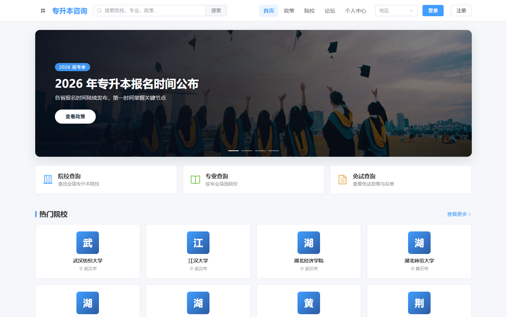
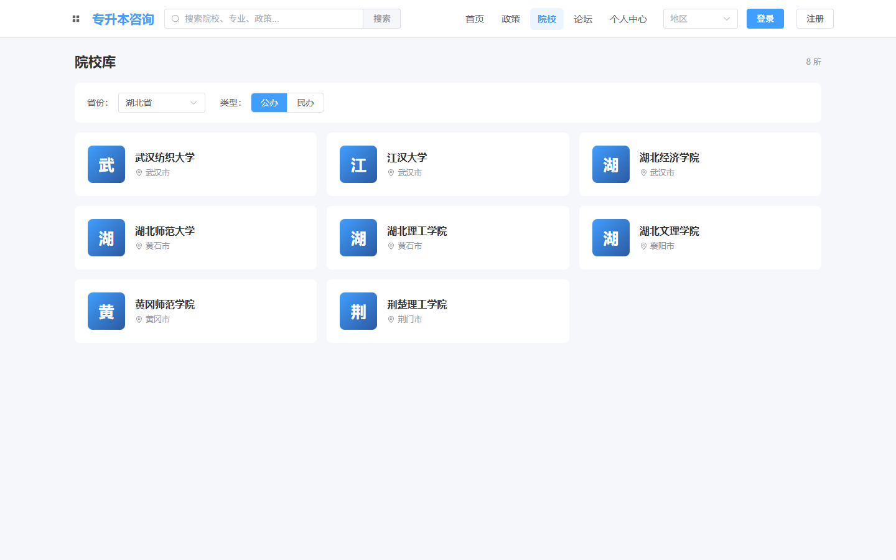
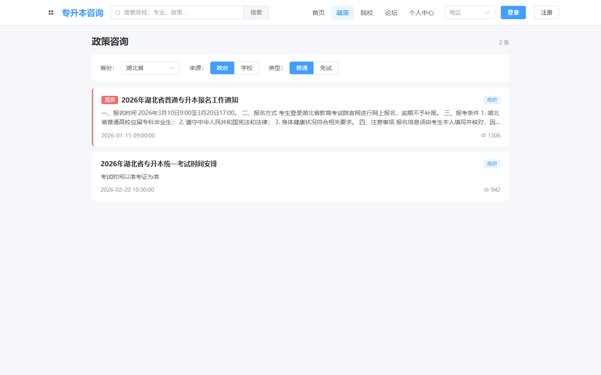
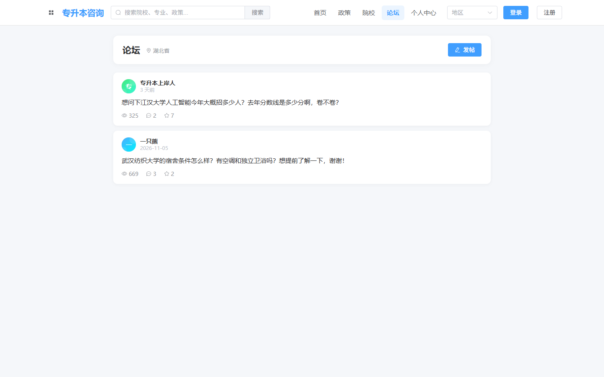
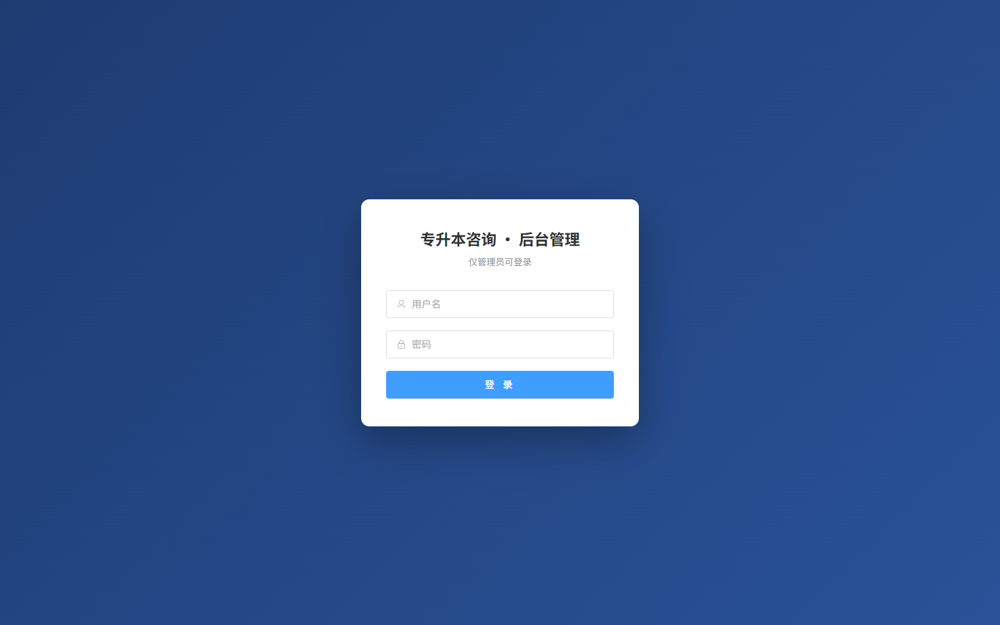

# 专升本咨询系统（ZSB）

面向专升本考生的信息查询与交流平台：学生端做「查院校 / 看政策 / 查招生计划 / 论坛交流」，管理端负责院校、专业、政策、招生计划、帖子与用户的后台维护。

前后端分离，三个独立工程同仓管理：`ZSB-user-web`（学生端）、`ZSB-admin-web`（管理端）、`zsb-server`（Spring Boot 后端）。

## 功能概览

| 端 | 模块 | 说明 |
| --- | --- | --- |
| 学生端 | 首页 | 热门院校、最新政策、数据概览 |
| 学生端 | 院校库 | 按省份 / 城市 / 类型筛选，院校详情含专业、招生计划、收藏 |
| 学生端 | 政策咨询 | 政策列表与详情，支持收藏 |
| 学生端 | 论坛 | 发帖、评论、点赞、按板块浏览 |
| 学生端 | 搜索 | 院校 / 专业 / 政策聚合搜索 |
| 学生端 | 个人中心 | 登录注册、资料修改、头像上传、我的帖子与收藏 |
| 管理端 | 仪表盘 | 院校 / 用户 / 帖子等统计 |
| 管理端 | 院校 / 专业 / 政策 / 招生计划 | 增删改查 |
| 管理端 | 帖子管理 | 列表、隐藏、删除 |
| 管理端 | 用户管理 | 列表、启用 / 禁用 |

## 界面截图

**学生端**

| 首页 | 院校库 |
| --- | --- |
|  |  |
| **政策咨询** | **论坛** |
|  |  |

**管理端**



## 技术栈

**后端**

| 组件 | 版本 / 说明 |
| --- | --- |
| JDK | 21 |
| Spring Boot | 3.2.4（Web + Validation） |
| MyBatis | mybatis-spring-boot-starter 3.0.3，注解式 Mapper |
| MySQL | 8.0，驱动 mysql-connector-j |
| 认证 | JWT（jjwt 0.11.5）+ 自定义 `AuthInterceptor` |
| 密码 | BCrypt（spring-security-crypto，不引入完整 Spring Security） |
| 构建 | Maven（含 wrapper，无需预装） |

**前端**

| 组件 | 版本 / 说明 |
| --- | --- |
| Vue | 3.5（`<script setup>` 组合式 API） |
| 构建 | Vite 8 |
| UI | Element Plus 2.14 + @element-plus/icons-vue |
| 状态 | Pinia |
| 路由 | vue-router（学生端 4.x / 管理端 5.x），history 模式 |
| 请求 | axios，统一封装于 `src/api/request.js` |
| 包管理 | pnpm |

## 目录结构

```
ZSB-web/
├── zsb-server/                 # 后端（Spring Boot 3 + MyBatis）
│   ├── src/main/java/com/zsb/zsbserver/
│   │   ├── controller/         # 接口层：User/School/Policy/Plan/Post/Major/Region/Admin
│   │   ├── service/            # 业务层
│   │   ├── mapper/             # 数据访问层（MyBatis Mapper）
│   │   ├── entity/             # 数据库实体
│   │   ├── dto/                # 入参对象（LoginDTO / RegisterDTO ...）
│   │   ├── vo/                 # 出参对象
│   │   └── common/             # Result 统一返回、JwtUtils、AuthInterceptor、全局异常
│   ├── src/main/resources/
│   │   └── application.yml     # 主配置（凭据用占位符，可提交）
│   └── pom.xml
├── ZSB-user-web/               # 学生端（Vue3 + Vite，:5173）
│   └── src/{api,components,layout,router,store,utils,views}
├── ZSB-admin-web/              # 管理端（Vue3 + Vite，:5174）
│   └── src/{api,components,layout,router,store,utils,views}
├── sql/                        # 建库脚本与数据脚本（按序号执行）
└── docs/后端接口文档.md         # 接口说明
```

后端采用四层结构：`Controller → Service → Mapper → Entity`，统一用 `Result{code,msg,data}` 返回，`code=200` 表示业务成功。

## 运行方式

### 1. 环境要求

- JDK 21
- Maven 3.9+（或直接用仓库自带 `mvnw`）
- Node.js 20.19+ / 22.12+（Vite 8 要求）、pnpm 9+
- MySQL 8.0

### 2. 初始化数据库

```bash
mysql -u root -p -e "CREATE DATABASE IF NOT EXISTS zsb DEFAULT CHARSET utf8mb4;"
```

按顺序执行 `sql/` 下脚本：

```bash
mysql -u root -p zsb < sql/01_schema.sql          # 建表（11 张表）
mysql -u root -p zsb < sql/02_seed.sql            # 基础演示数据
mysql -u root -p zsb < sql/03_region_cities.sql   # 省市区字典
mysql -u root -p zsb < sql/04_multi_province_data.sql  # 多省份院校/专业/计划
mysql -u root -p zsb < sql/05_cleanup_test_data.sql    # 可选：清理测试数据
```

### 3. 配置后端凭据

`application.yml` 只存放占位符，真实密码不提交仓库。二选一：

**方式 A（推荐）**：在 `zsb-server/src/main/resources/` 下新建 `application-local.yml`（已被 `.gitignore` 忽略）：

```yaml
spring:
  datasource:
    username: root
    password: 你的数据库密码

zsb:
  jwt:
    secret: 你的随机长字符串
```

**方式 B**：设置环境变量 `MYSQL_USERNAME` / `MYSQL_PASSWORD` / `MYSQL_HOST` / `MYSQL_PORT` / `JWT_SECRET`。

### 4. 启动后端

```bash
cd zsb-server
./mvnw spring-boot:run          # Windows: mvnw.cmd spring-boot:run
```

默认 `http://localhost:8080`；上传的图片写到运行目录下的 `uploads/`，通过 `/uploads/**` 访问。

### 5. 启动前端

```bash
cd ZSB-user-web && pnpm install && pnpm dev    # http://localhost:5173
cd ZSB-admin-web && pnpm install && pnpm dev   # http://localhost:5174
```

两个前端都把 `/api` 代理到 `http://localhost:8080` 并去掉前缀，所以后端接口按 `http://localhost:8080/user/login` 这样的路径访问。生产构建：`pnpm build`，产物在 `dist/`。

## 接口约定

- 统一返回体：`{ "code": 200, "msg": "success", "data": ... }`
- 鉴权：登录后返回 JWT，前端放在 `Authorization: Bearer <token>` 头；`AuthInterceptor` 校验后把用户信息放入请求上下文
- 字段命名：后端全局 `SNAKE_CASE`，即 `userId` 序列化为 `user_id`
- 文件上传：`POST /upload` 返回图片可访问 URL

完整接口清单见 [`docs/后端接口文档.md`](docs/后端接口文档.md)。

## 数据表

`user`、`region`、`major`、`school`、`policy`、`recruitment_plan`、`post`、`post_comment`、`post_like`、`comment_like`、`favorite`。

## 说明

- 仓库不包含 `node_modules/`、`dist/`、`target/`、`uploads/`、IDE 配置与本地凭据文件。
- `docs/` 下仅提交接口文档，其余为本地笔记，已被 `.gitignore` 排除。
